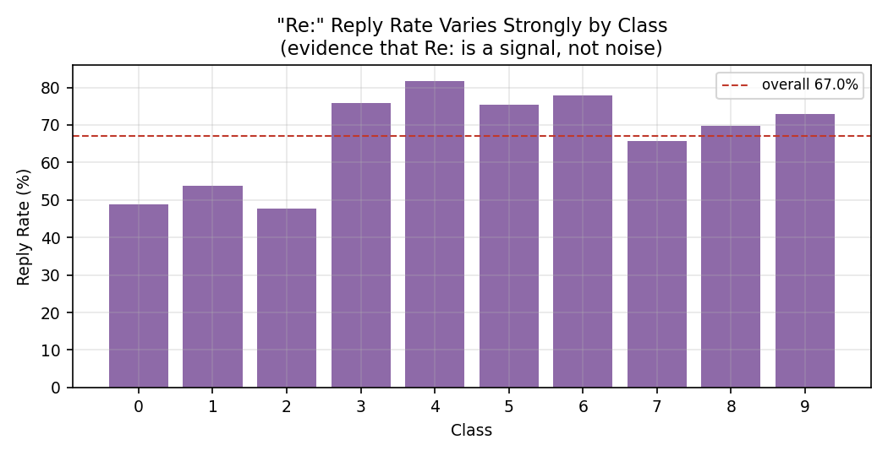
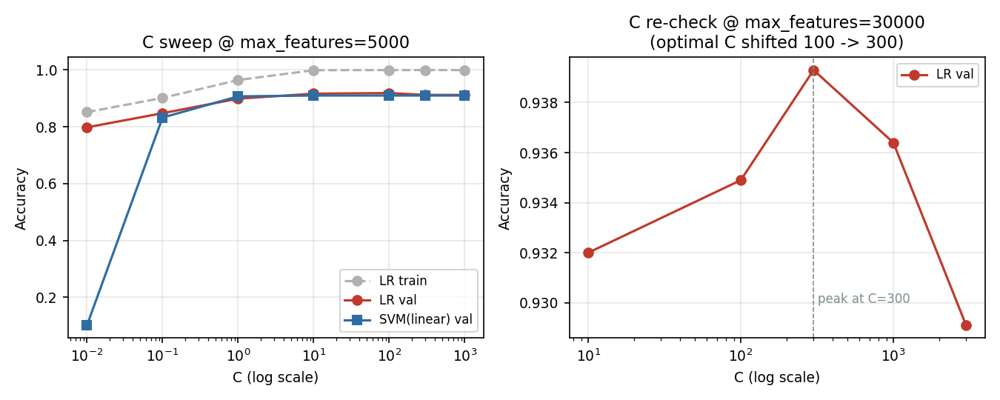
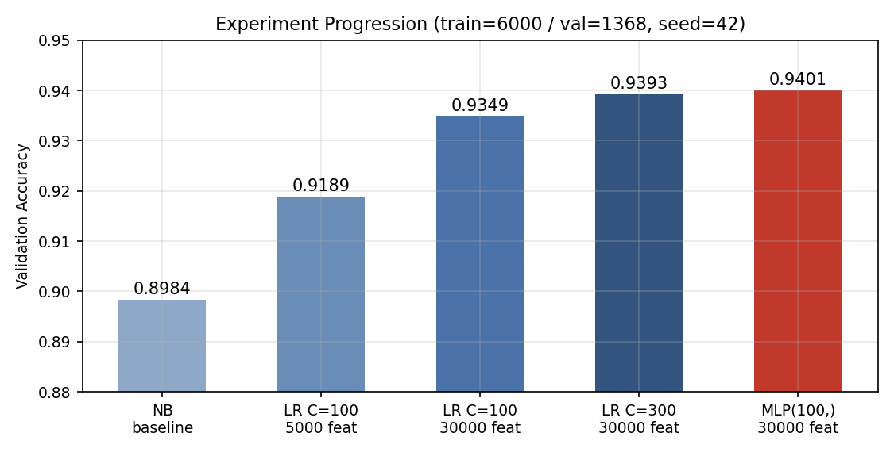
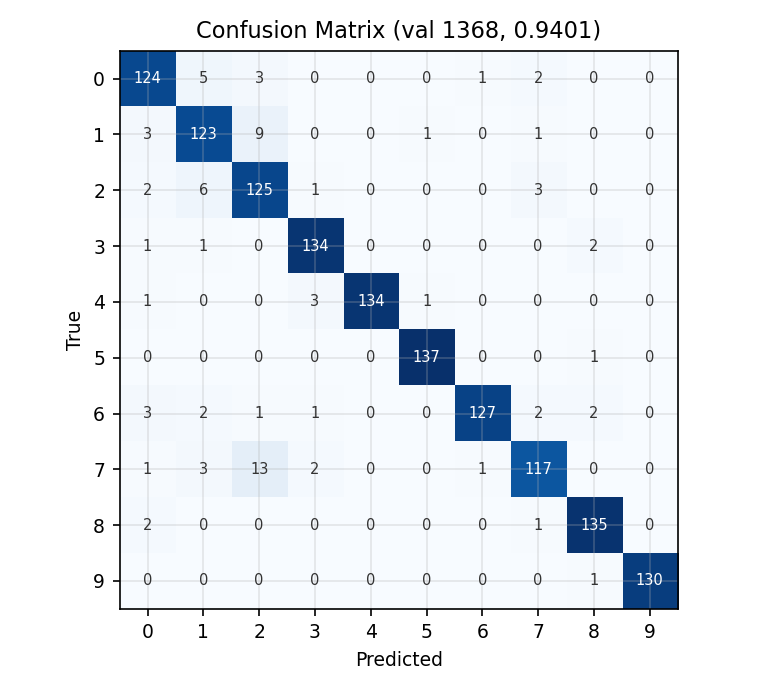
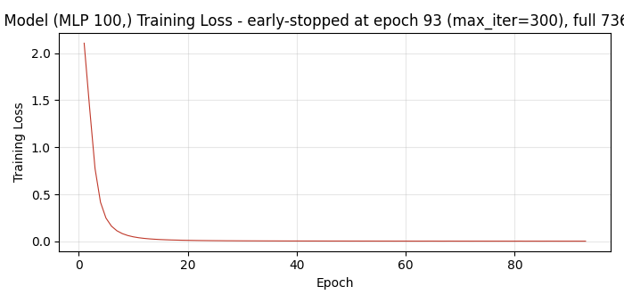

# 实验一：新闻文本分类实验报告

**姓名**：徐健　**学号**：10245501464　**日期**：2026-09-24

## 1 任务、方案与结果

**任务**：10 类新闻组文本分类。训练集 7368 条（text+target），测试集 2457 条（无标签）。
**最终方案**：剥邮件头 + TF-IDF(max_features=30000, unigram) + MLP 单隐层(100 神经元)。
**结果**：验证集（固定划分 6000/1368、分层、**random_state=42**）94.01%，5 种子复验均值
**94.28% ± 0.29%**，macro-F1 0.9404；较朴素贝叶斯基线 89.84% 提升约 4.4 个百分点。
**提交与复现**：`predictions.csv`（2457 行预测，与示例同格式）；`python main.py` 从原始 CSV
一键复现全部结果；**全局随机种子固定为 42**（划分、模型初始化、重训一致）。

## 2 数据与预处理

文本为 1993 年新闻组邮件，99.8% 含邮件头，直接删去。
**假设检验**：之前做假设 "Re:" 的回帖标记与引用归属行是噪声。删除后验证集结果 91.89%→91.23%。
猜测是回帖率随类别剧烈分化比如摩托车组 81.8% ， 硬件组 47.6%（图 1）。给我的结论是——
**高频并不一定是无信息，类条件分布差异才是判据**，所以保留。
停用词方案实测 −0.30pp ，所以不采用，因为sklearn 的 `idf(w)=ln((1+N)/(1+df(w)))+1` 已弱化高频词。

**图 1** 各新闻组回帖率差异（"Re:" 是类别信号而非噪声的证据）

## 3 特征工程与调参

**TF-IDF**：TF 词频 × IDF 逆文档频率。词表上限曲线 3000→30000 词单调提升
（88.8%→93.5%），30000 后平台（自然词表 9.7 万，长尾零贡献）；ngram(1,2) 全部档位负收益
（−0.8~−2.3pp，虚词 bigram 挤占判别词名额）。

**模型原理**：朴素贝叶斯（词条件独立，作基线）；逻辑回归（词投票权重 + softmax）；
SVM（最大间隔）；MLP（多层非线性）。

**C 扫参**（对数间隔 0.01~1000，图 2）：两模型的 C 含义一致，均为正则化强度的倒数
（目标函数 (1/2)‖w‖² + C·Σ损失）。C=0.01 欠拟合（SVM 训练/验证仅 10%），C 增大验证先升后降，
LR 在 C=100 达 91.89%；词表扩至 30000 后**重验 C，最优值漂移至 300**（93.93%）——
特征维度变化后必须重验正则化（坐标下降）。

**MLP 结构实验**：默认 (100,) 即达 94.01%；加宽 (200,) 仅 +0.14pp 但训练耗时 95 分钟；
加深 (100,50) 下降 0.59pp（过拟合）；加 epochs（300→1000）无变化——损失曲线显示
模型约 93 轮即触发提前停止（n_iter_no_change=10），早已收敛。

**图 2** C 扫参（左：欠拟合→过拟合完整曲线；右：30000 特征下最优 C 漂移至 300）

## 4 结果与分析

**进化链**（图 3）：89.84%（NB）→ 91.89%（LR C=100）→ 93.49%（扩词表）→ 93.93%（重调 C）→
**94.01%（MLP）**。

**图 3** 实验进化链

**误差分析**（图 4）：类别 0/1/2（图形/Windows/PC 硬件）混淆最多——三组话题重叠、
词表互窜；主题独特的类别 5/9 达 0.97+。线性模型权重检查与混淆矩阵一致，误差源于数据本身。

**图 4** 混淆矩阵（验证集 1368 条，94.01%）

**模型选择（性能 × 复杂度）**：多种子复验 LR 93.73%±0.55% vs MLP **94.28%±0.29%**，
MLP 在全部 5 个种子上获胜——优势稳定而非划分运气。MLP(100,) 单隐层复杂度可控
（全量重训约 10 分钟），稳定 +0.5pp 值得成本；加宽/加深不采用（成本爆炸/过拟合）。

**训练过程**（图 5）：最终模型的逐轮训练损失曲线，取自 sklearn 训练过程中真实记录的
`loss_curve_`，**未做任何平滑**。初始损失 2.10，前 10 轮剧烈下降至 0.04（相邻轮波动均值
0.207，小批量随机梯度的正常毛刺），此后波动递减，最后 10 轮波动 <0.0001，收敛至 0.0032；
模型在**第 93 轮触发提前停止**（n_iter_no_change=10，max_iter=300 未跑满）。
原始数据存于 loss_curve.csv 可核对。

**图 5** 最终模型训练损失曲线（全量 7368 条，93 轮提前收敛，未平滑的真实记录）

**局限性**：单一划分存在选择偏差（已以 5 种子复验量化）；MLP(200,) 因 95 分钟训练成本
未做多种子验证；结论仅限该英文新闻组语料。

## 5 结论与思考题

**结论**：种子 42 下全流程可复现；最终模型对测试集的预测已提交为 `predictions.csv`。

**思考 1（线性模型为何在文本上强）**：特征高维（30000 维 > 样本数）且稀疏，数据近乎
线性可分；C 正则化抑制"背题"；IDF 天然完成特征缩放。

**思考 2（MLP 能否提升？过拟合风险？）**：加宽微涨但成本爆炸、加深过拟合、epochs 无效；
训练 99.98% vs 验证 94.3% 的差距表明过拟合风险高于线性模型，单隐层小网络是最佳平衡点。

**思考 3（其他文本表示）**：BoW 丢语序；Word2Vec 词向量捕捉语义但需文档聚合；
BERT 最强但对本任务属杀鸡用牛刀。TF-IDF 至今仍是中小规模文本分类的工业级基线。
